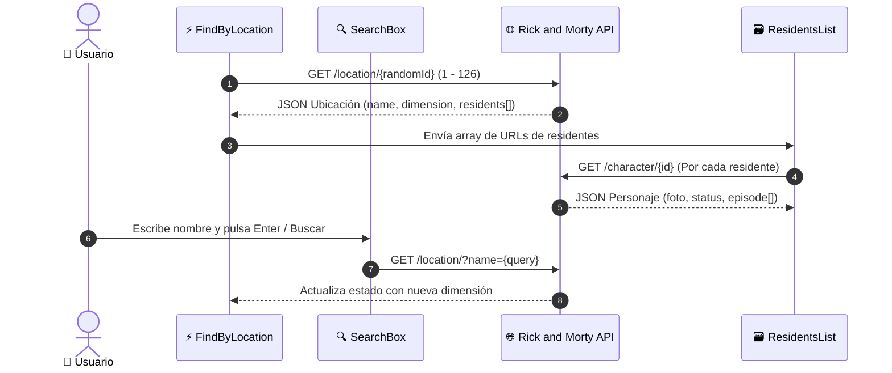

<div align="center">

# 🛸 Rick and Morty · Explorer de Dimensiones y Residentes

[](https://reactjs.org/)
[](https://developer.mozilla.org/es/docs/Web/JavaScript)
[](https://rickandmortyapi.com/)
[](https://axios-http.com/)
[](#)

<p align="center">
  <strong>Aplicación web en React para explorar las dimensiones, planetas y personajes del multiverso de Rick and Morty.</strong><br>
  Carga aleatoria de ubicaciones, buscador inteligente y fichas interactivas con estado de vida, especie y episodio de origen.
</p>

[✨ Características](#-características-principales) •
[🏛️ Arquitectura](#-arquitectura-de-componentes) •
[🌐 Consumo de API](#-consumo-de-api-y-flujo-de-datos) •
[🚀 Guía de Instalación](#-guía-de-instalación-y-ejecución) •
[🤖 Créditos](#-créditos--asistencia-técnica)

</div>

---

## 📌 Visión General

**Rick and Morty Explorer** es una SPA (Single Page Application) desarrollada con **React** y **Axios** que consume la API oficial de [The Rick and Morty API](https://rickandmortyapi.com/).

Al ingresar, la aplicación selecciona una dimensión o planeta aleatorio entre las 126 ubicaciones del multiverso, renderiza sus metadatos (nombre, tipo, dimensión) y realiza peticiones concurrentes para listar las tarjetas de todos sus residentes.

---

## ✨ Características Principales

* 🎲 **Ubicación Aleatoria de Inicio:** Carga dinámica de un ID aleatorio del 1 al 126 al montar el componente.
* 🔍 **Buscador con Autocompletado y Manejo de Errores:** Búsqueda por nombre de dimensión con protección ante búsquedas sin resultados (`404 catch`).
* 👾 **Tarjetas de Residentes:**
  * Indicador de estado vital (`Alive`, `Dead`, `unknown`).
  * Especie y planeta de origen.
  * Extracción limpia del **episodio de su primera aparición** (cálculo de ID de episodio sin bucles innecesarios).
* 🛡️ **Anti-Hanging en Cero Residentes:** Manejo de estado para planetas deshabitados sin quedar atrapado en pantallas de carga infinitas.

---

## 🏛️ Arquitectura de Componentes

```text
rick-and-morty/
├── public/
│   ├── favicon.ico
│   ├── index.html
│   └── manifest.json
├── src/
│   ├── assets/
│   │   └── img/
│   │       └── rick.jpg               # Avatar para caja de búsqueda
│   ├── components/
│   │   ├── CharacterInfo.js           # Especie, origen y primer episodio
│   │   ├── FindByLocation.js          # Orquestador principal de estado
│   │   ├── LocationInfo.js            # Tarjeta de metadatos de la dimensión
│   │   ├── Residents.js               # Tarjeta individual del personaje
│   │   ├── ResidentsList.js           # Contenedor flex/grid de residentes
│   │   └── SearchBox.js               # Formulario de búsqueda con validación
│   ├── helpers/
│   │   └── locationHelpers.js         # Generador de ID y parser de URLs
│   ├── App.css                        # Estilos multiverso y responsive
│   ├── App.js                         # Contenedor raíz
│   └── index.js                       # Renderizado en DOM
├── package.json
└── README.md
```

---

## 🌐 Consumo de API y Flujo de Datos



---

## 🚀 Guía de Instalación y Ejecución

### 1. Clonar el repositorio
```bash
git clone https://github.com/Luaz2021/rick-and-morty.git
cd rick-and-morty
```

### 2. Instalar dependencias
Compatible con Node.js 16, 18, 20 y 24+:
```bash
npm install --legacy-peer-deps
```

### 3. Iniciar la aplicación
```bash
npm start
```
Abre automáticamente [http://localhost:3000](http://localhost:3000) en tu navegador.

---

## 🤖 Créditos & Asistencia Técnica

* **Desarrollo & Lógica Principal:** Alexander Martínez ([@Luaz2021](https://github.com/Luaz2021))
* **QA Tester, Auditoría de Código, Refactorización & Documentación README:** Generado por **Agent-Nova-Gemini-Assistant** ✨ (Copiloto y Asistente Técnico Autónomo basado en Google Gemini).

---
<div align="center">
  <sub>Desarrollado con fines educativos y de portfolio profesional · 2026</sub>
</div>
